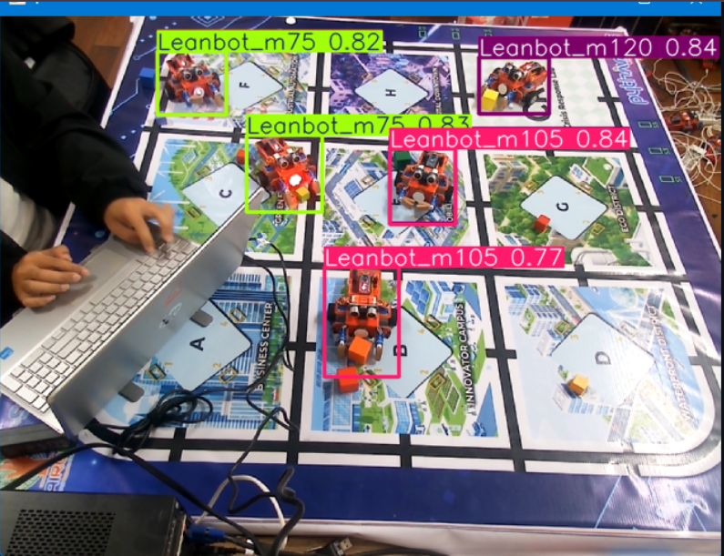
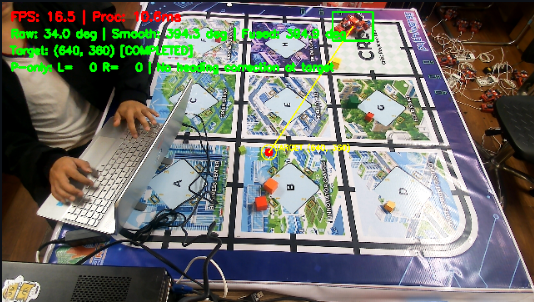
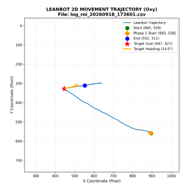
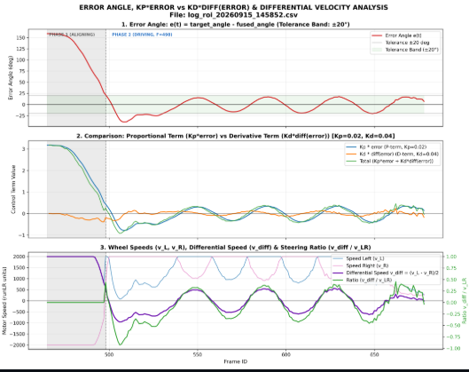

# Báo cáo tiến độ nghiên cứu ngày 09/10/2026

**Đề tài ( tên dự kiến):** Ước lượng góc định hướng 0-360° của robot Leanbot từ camera cố định bằng CNN-based Object Detection.
## A. Tổng quan dự án
- Hiện tại dự án em nghiên cứu và thực hiện trên Công Ty DTT do Thầy Quảng hướng dẫn trực tiếp đã hoàn thành và giải quyết một số nội dung bài toán nhưu sau ạ : 

1. **Bài toán:** 
    - Nhận diện, phát hiện vị trí và ước lượng góc định hướng của robot Leanbot trên mặt phẳng 2D bằng một camera cố định ( đặt chéo 45 độ ở một phía sa bàn) 
    - Thông qua vị trí và góc định hướng ,hệ thống máy chủ sẽ điều hướng Leanbot tới vị trí yêu cầu trên sa bàn thôgn qua hình ảnh từ Camera. 

2. **Mục tiêu:**
    - Ước lượng hướng quay từ 0-360°, phân biệt góc dương/âm mà không cần dùng mô hình các mô hình keypoint pose estimation cần dữ liệu huấn luyện và quy trình thu thập dữ liệu phức tạp
    - Áp dụng bộ điều khiển PID tính toán lệnh điều khiển, gửi lệnh điều khiển thôgn qua BLE để Leanbot di chuyển tới vị trí yêu cầu

    - Ảnh ví dụ minh họa khi nhận diện góc Leanbot (Leanbot_m75 nghĩa là minus 75 degree : -75 độ):

    

    - Ảnh thực tế triển khai khi điều khiển : 

    

    - Ảnh đường quỹ đạo di chuyển : 

    

    - Ảnh đồ thị các dữ liệu quan sát : 

    
3. **Một số kết quả kỹ thuật bước đầu:**
    - Đã xây dựng được mô hình phát hiện Leanbot và ước lượng góc định hướng bao phủ toàn bộ 360°, bao gồm các góc có dấu trong bốn góc phần tư đường tròn lượng giác. 
    - Bộ dữ liệu của phiên bản huấn luyện ngày gần nhất ( 11/09/2026) gồm 204 ảnh, 24 lớp góc 
    - Đã triển khai phương pháp kết hợp Soft Angular BCE và Weighted Circular Mean nhằm khai thác quan hệ tuần hoàn giữa các lớp góc, từ đó suy ra góc liên tục.
    - Đã tích hợp mô hình vào hệ thống nhận diện, theo dõi và điều khiển chuyển động của Leanbot bằng PID controller với camera cố định.

## B. Nội dung trọng tâm và kết quả hiện tại

1. **Hệ thống thu thập dữ liệu huấn luyện (dataset):** Đã triển khai bộ công cụ, quy trình thu thập ảnh, tách nền và tự động tạo nhãn bounding box
2. **Huấn luyện mô hình:** Sử dụng **YOLO11n** và triển khai chỉnh sửa hàm Loss function thành **Soft Angular BCE** nhằm xét đến tính tuần hoàn và liên hệ giữa các class góc. 
3. **Suy ra góc liên tục:** Dùng **weighted circular mean** trên điểm dự đoán (confidence) của các lớp góc để tính toán ra góc (có dấu) trong miền [−180°, 180°].
4. **Triển khai inference thực nghiệm :** Đã triển khai, export sang mô hình dạng **OpenVINO FP16** với 2 chế độ **Full Detection 640×640** và **ROI Tracking 160×160**, có cơ chế chuyển về tìm kiếm toàn ảnh nếu không phát hiện được Leanbot. 

- Theo như gợi ý của Thầy hôm qua thì em chia dự án thành các nội dung chính có thể đào sâu để viết bài publication như sau ạ : 

### 1. Phương pháp xác định góc xuay của vật thể từ camera cố định ứng dụng mô hình Yolo detection 
- **Thành phần thuật toán hiện tại (cần đối chứng để đánh giá tính mới)** : 
    - Đã triển khai cơ chế tạo nhãn mềm tuần hoàn Gaussian kết hợp BCE (Soft Angular BCE); nguyên lý có quan hệ trực tiếp với CSL 2020, vì vậy chưa coi công thức này là một loss mới độc lập. 
        - Mục đích thay thế BCE (Binary Cross Entropy loss) mặc định của YOLO model , vốn chỉ xem mỗi nhãn là độc lập, khôgn có mối quan hệ gì với nhau ( ví dụ Leanbot 0 độ và Leanbot 15 độ được xem là độc lập hoàn toàn không có sự tương đồng nào gần nhau)
        - Tuy nhiên với bài toán xác định góc thì các nhãn có mối quan hệ với nhau ( ví dụ Leanbot 0 độ, nhìn gần giống với Leanbot 15 độ) 
        - Từ các mối quan hệ mờ này ta có thể ước lượng được góc giữa các nhãn gần nhau thông qua cơ chế cộng vector Confidence ( trọng số dự đoán ) của các nhãn. 
- Phân tích dữ liệu raw của model Yolo trước khi đi qua lớp lọc NMS ( lớp lọc giữ lại dự đoán có confidence cao nhất ) :
    - Dữ liệu trước lớp NMS là dữ liệu thô output trực tiếp từ model, nó chứa toàn bộ trọng số dự đoán của các class góc của Leanbot. Thôgn qua dữ liệu này để tính toán vector tổng hợp trọng số confidence để tính toán ra góc ước lượng 
- **Điểm đóng góp bổ sung ( thực nghiệm)** : 
    - Cơ chế thu thập dữ liệu ; đánh nhãn tự động và tự động tạo dataset cho mô hình huấn luyện 
    - Các cơ chế làm mịn dữ liệu thô bị nhiễu sau khi ước lượng góc được áp dụng để tăng ổn định và độ chính xác output: 
        - **Temporal Angle Smoothing**: Làm mượt chuỗi góc dự đoán theo thời gian bằng cách unwrap góc và hồi quy đa thức bậc nhất trên cửa sổ dữ liệu trượt, hạn chế dao động giữa các frame.
        - **Trajectory-based Heading Estimation**: Ước lượng hướng chuyển động dựa trên quỹ đạo tọa độ tâm robot ((x,y)) quan sát được qua nhiều frame.
        - **Velocity-Adaptive Angle Fusion**: Kết hợp góc từ mô hình CNN và hướng quỹ đạo với trọng số thay đổi theo vận tốc chuyển động : Khi robot gần đứng yên, ưu tiên góc CNN model detect ; khi robot chuyển động rõ ràng, tăng trọng số của hướng quỹ đạo.

#### Kết quả khảo sát sơ bộ — 5 công trình liên quan nhất đến CNN/YOLO và ước lượng góc tuần hoàn

> **Phân biệt bài toán:** CSL/YOLO-CSL/adaptive angle classification chủ yếu dự đoán góc của *rotated bounding box* (OBB, có thể chỉ quy ước trong 90°/180°). Tuy nhiên bài toán Leanbot là **directed heading 360°**, phân biệt đầu và đuôi robot. Vì thế **mAP OBB không thể so trực tiếp với circular MAE của Leanbot**. 

##### 1. Arbitrary-Oriented Object Detection with Circular Smooth Label — ECCV 2020

- **Thông tin bài báo:** Xue Yang, Junchi Yan; *European Conference on Computer Vision (ECCV 2020)*, LNCS 12353, tr. 677–694. [Trang công bố](https://www.ecva.net/papers/eccv_2020/papers_ECCV/html/666_ECCV_2020_paper.php) · [DOI](https://doi.org/10.1007/978-3-030-58598-3_40).
- **Bài toán và phương pháp:** Xử lý sự gián đoạn khi hồi quy góc OBB qua biên chu kỳ: thay angle regression bằng **angle classification**, thêm **Circular Smooth Label (CSL)** để các lớp góc lân cận có nhãn mềm tuần hoàn; khảo sát hàm cửa sổ (bao gồm Gaussian) và độ rộng cửa sổ.
- **Kết quả/đối chứng:** Đánh giá các detector/biểu diễn góc, ảnh hưởng window và radius trên **DOTA, HRSC2016, ICDAR2015, MLT**; chứng minh khả năng khắc phục lỗi biên trong rotated detection. Không báo cáo trực tiếp sai số directed heading 360° cho robot.
- **So với Leanbot:** **Có:** lớp góc rời rạc, khoảng cách góc tuần hoàn, Gaussian soft targets — rất gần **Soft Angular BCE** mà em sử dụng . **Chưa có đề cập trong bài:** 24 class biểu diễn hướng đầu–đuôi robot 360°, tổng hợp raw class scores trước NMS để suy ra góc liên tục, và thí nghiệm vài trăm ảnh.
- **Có thể sử dụng để:** trích dẫn (prior work) + baseline loss:** đối chiếu **YOLO11n hard BCE** với **circular soft-label BCE/CSL** trên cùng bộ ảnh Leanbot. 

##### 2. Detection of Objects in Satellite and Aerial Imagery Using Channel and Spatially Attentive YOLO-CSL for Surveillance — 2024

- **Thông tin bài báo:** Divyansh Chaurasia, B. D. K. Patro; *Image and Vision Computing*, **147**, 105070 (2024). **SJR 2025: Q1 (Computer Vision and Pattern Recognition); JCR 2025: Q2 (Computer Science, Artificial Intelligence), Q1 (Computer Science, Software Engineering)** theo ngành. [Nhà xuất bản](https://www.sciencedirect.com/science/article/pii/S0262885624001744) · [DOI](https://doi.org/10.1016/j.imavis.2024.105070).
- **Bài toán và phương pháp:** Phát hiện vật thể quay trong ảnh viễn thám; tích hợp **YOLOv5 + nhánh dự đoán góc riêng**, **Circular Smooth Labels + BCEWithLogits** và channel/spatial attention.
- **Kết quả/đối chứng:** Tác giả báo cáo **mAP 57,86 trên DOTA-v2**, cao hơn phương pháp đứng thứ hai trong bảng so sánh **0,20 điểm mAP**; mô hình khoảng **25 triệu tham số, 54 GFLOPs**. Đây là mAP detection OBB, không phải sai số heading.
- **So với Leanbot:** **Có:** YOLO + phân loại góc + nhãn mềm tuần hoàn + BCE — **rất gần thiết kế thuật toán**. **Khác:** dùng *angle branch* riêng cho OBB, còn Leanbot mã hóa 24 hướng đầu robot thành detection classes và dùng **weighted circular mean** trên scores; không đánh giá bài toán tracking/heading robot 360°.
- **Vai trò sử dụng khi viết báo:** **có thể là lựa chọn trích dẫn cao (prior work sát nhất về YOLO + CSL + BCE)**. Có thể thiết kế **baseline YOLO + angle branch** hoặc, tối thiểu, đối chứng nhãn cứng/nhãn mềm trong cùng YOLO11n. 
##### 3. Biternion Nets: Continuous Head Pose Regression from Discrete Training Labels — GCPR 2015

- **Thông tin bài báo:** Lucas Beyer, Alexander Hermans, Bastian Leibe; *German Conference on Pattern Recognition (GCPR 2015)*, LNCS 9358, tr. 157–168. [Trang tác giả và mã nguồn](https://www.vision.rwth-aachen.de/publication/0021/) · [DOI](https://doi.org/10.1007/978-3-319-24947-6_13).
- **Bài toán và phương pháp:** Dự đoán **góc hướng liên tục 360°** khi nhãn training chỉ là các góc thô/rời rạc, tránh gián đoạn tại 0°/360°; CNN hồi quy trực tiếp **biternion $(\cos\theta,\sin\theta)$** thay vì chia góc thành nhiều classes.
- **Kết quả/đối chứng:** So sánh các mô hình hồi quy/phân loại trên nhiều bộ dữ liệu hướng đầu; báo cáo hiệu quả của biternion từ coarse labels.
- **So với Leanbot:** **Có:** directed orientation 360°, nhãn góc thưa, đầu ra liên tục, không đòi gán nhãn keypoint. **Khác:** không phải detector YOLO tích hợp class heading và không dùng Soft Angular BCE, pre-NMS scores hay vòng điều khiển Leanbot.
- **Vai trò sử dụng khi viết báo:** **Baseline ước lượng góc bắt buộc:** huấn luyện **CNN/YOLO ROI backbone + sin/cos head** trên **cùng train/test split** với 24-class Soft Angular BCE; so sánh và đánh giá bằng các metric **circular MAE, lỗi vùng biên 0°/360°, chi phí dữ liệu** để lấy dữ liệu so sánh độ hiệu quả của của phương pháp đề xuất .

##### 4. A Deep Learning Framework for Accurate Vehicle Yaw Angle Estimation from a Monocular Camera Based on Part Arrangement — 2022

- **Thông tin bài báo:** Wenjun Huang và cộng sự; *Sensors*, **22(20)**, 8027 (2022). **SJR 2025: Q1 (Instrumentation); JCR 2025: Q2 (Instruments & Instrumentation)** theo ngành. [Bài báo mở](https://www.mdpi.com/1424-8220/22/20/8027) · [DOI](https://doi.org/10.3390/s22208027).
- **Bài toán và phương pháp:** Ước lượng **yaw của xe có hướng** từ một camera RGB; mạng **YAEN** gồm bộ mã hóa sắp xếp bộ phận xe (đầu/đuôi, đèn, gương...) và CNN decoder để dự đoán yaw. Không phụ thuộc rotated-box angle classification.
- **Kết quả/đối chứng:** Trên dữ liệu thực đo của tác giả, **sai số trung bình dưới 3,1°**, **96,45% dự đoán có sai số dưới 10°**, **97 FPS trên RTX 2070 Super**; kết quả có điều kiện về quan sát/bị che khuất và không tái sử dụng trực tiếp cho Leanbot.
- **So với Leanbot:** **Có:** bài toán heading/yaw trực tiếp, monocular camera, mô hình CNN gọn, đánh giá sai số góc thực. **Khác:** cần thông tin/học các **bộ phận xe** thay vì nhãn bbox+góc robot; dữ liệu/thành phần hình học khác, không khai thác 24 class scores và weighted circular mean.
- **Vai trò có thể sử dụng khi viết báo:** **Trích dẫn cao — Related Work heading bằng monocular CNN, tham khảo cách thu ground truth và thước đo sai số**. 

##### 5. Rotated Object Detection Using Adaptive Angle Classification and Dynamic Sample Matching — 2026

- **Thông tin bài báo:** Liu Han, Zhou Peng, Yan Han; *Chinese Journal of Engineering*, **48(3)**, 586–598 (2026). **SJR 2025: Q2 (Engineering); [Nhà xuất bản](https://cje.ustb.edu.cn/en/article/doi/10.13374/j.issn2095-9389.2025.06.09.006) · [DOI](https://doi.org/10.13374/j.issn2095-9389.2025.06.09.006).
- **Bài toán và phương pháp:** Đối tượng quay trong viễn thám/ký tự công nghiệp; cải tiến YOLOv8 bằng **shape-aware adaptive angle classification (SA-ASL)** với **circular Gaussian window có độ rộng phụ thuộc hình dạng đối tượng** và progressive dynamic matching (hIoU → rIoU).
- **Kết quả/đối chứng:** **mAP 78,6% trên DOTA**, **92,4% trên tập ký tự công nghiệp**; ablation báo cáo tăng **4,3% ở nhóm lớp nhạy với góc** nhờ angle classification thích nghi (theo tác giả). Không phải thí nghiệm directed heading 360°.
- **So với Leanbot:** **Có:** nhãn mềm Gaussian tuần hoàn, YOLO, quan tâm độ bất định theo góc. **Khác:** độ rộng nhãn **thích nghi** theo tỷ lệ box thay vì $\sigma = 15^\circ$ cố định; giải góc OBB và ghép mẫu rIoU, không xử lý class heading và circular-mean scores như Leanbot.
- **Vai trò có thể sử dụng khi viết báo:** **Trích dẫn — prior work mới (2026) + gợi ý ablation**: thử $\sigma$ cố định so với thay đổi; cân nhắc uncertainty-aware target.

**Kết luận khảo sát sơ bộ:** (1) CSL đã giải quyết **tính tuần hoàn của các lớp góc**; (2) YOLO-CSL chứng minh **YOLO + CSL + BCE không còn là phương pháp mới**; (3) Biternion chứng minh có thể **ước lượng góc liên tục 360° từ nhãn thưa**; (4) YAEN là prior work trực tiếp về **camera monocular + yaw có hướng**; (5) nghiên cứu năm 2026 cho thấy circular soft labels vẫn được cải tiến (adaptive widths). 

**Benchmark có thể thực nghiệm để đánh giá phương pháp đề xuất và phương pháp của các bài báo có thể như sau :** Giữ cùng bộ dữ liệu Leanbot với ground truth góc độc lập và tách train/test theo session: **(A)** YOLO11n + hard-label BCE + argmax; **(B)** YOLO11n + Soft Angular BCE + argmax; **(C)** YOLO11n + Soft Angular BCE + weighted circular mean; **(D)** sin/cos regression (Biternion baseline). Báo cáo **circular MAE**, lỗi tại biên 0°/360°, latency; thêm ablation $\sigma$ khi có kết quả nền. Không so trực tiếp chỉ số từ các bộ dữ liệu/phần cứng khác nhau.

#### Đối chiếu chuyên sâu: CSL và phương pháp Leanbot (định hướng publication)

**Nguồn đối chiếu trực tiếp:** [CSL — ECCV 2020](https://www.ecva.net/papers/eccv_2020/papers_ECCV/html/666_ECCV_2020_paper.php) ([PDF](https://www.ecva.net/papers/eccv_2020/papers_ECCV/papers/123530664.pdf)); [bản mở rộng của chính tác giả — IJCV 2022](https://doi.org/10.1007/s11263-022-01593-w) ([bản thảo](https://arxiv.org/pdf/2003.05597)); [YOLO-CSL — Image and Vision Computing 2024](https://doi.org/10.1016/j.imavis.2024.105070). Mã Leanbot đang đối chiếu: [notebook huấn luyện SoftBCE](https://github.com/HoangAnh301194/Leanbot_orientation_estimation-CNN_base/blob/master/Leanbot_Camera_AI_Control_FINAL/tools/Leanbot_Train_SoftBCE.ipynb), [phân tích score trước NMS](https://github.com/HoangAnh301194/Leanbot_orientation_estimation-CNN_base/blob/master/Leanbot_Camera_AI_Control_FINAL/tools/check_confidence.py).

##### (a) Vấn đề học thuật: giống nhau ở đâu?

- **Cả hai đều chuyển góc thành phân loại trên vòng tròn**, dùng khoảng cách góc có tính chu kỳ và tăng mức tương đồng của những lớp góc gần nhau. Vì vậy, không thể coi ý tưởng **Gaussian circular soft labels** là mới của Leanbot.
- **CSL 2020:** Dự đoán góc của *rotated bounding box* (OBB) bằng một nhánh **angle classification**; góc được mã hóa bởi các bin góc và nhãn cửa sổ tuần hoàn. Nhóm tác giả khảo sát cửa sổ pulse/rectangular/triangular/Gaussian; hàm mất mát nhánh góc có thể là sigmoid cross-entropy hoặc focal loss tùy detector, **không đơn thuần là một “loss Gaussian” mới**. Miền góc OBB theo quy ước bài báo thường là 180°, còn độ phân giải bin có thể rất nhỏ, ví dụ 1°.
- **Leanbot:** Có 24 lớp theo chu kỳ 360°, mỗi lớp cách 15°. Nhãn mềm Gaussian được áp vào **classification targets của chính YOLO11n detection head**, thay vì huấn luyện một nhánh angle classification độc lập. Đây là **khác biệt cách tích hợp/kiến trúc**, chưa phải bằng chứng tự thân về tính mới hoặc độ chính xác tốt hơn.

##### (b) Đối chiếu cơ chế tạo nhãn và loss

Với CSL, biểu diễn tổng quát có dạng:

\[
y_j^{CSL}=g\big(d_T(\theta_{gt},\theta_j)\big),\quad
d_T(a,b)=\min(|a-b|,T-|a-b|),
\]

trong đó \(T\) là chu kỳ của góc OBB theo quy ước, còn \(g\) là hàm cửa sổ. Trong thiết kế CSL gốc, cửa sổ có **bán kính hữu hạn** \(r\): ngoài cửa sổ, mục tiêu bằng 0. Trường hợp Gaussian là **một lựa chọn** của CSL, không phải toàn bộ CSL chỉ gồm Gaussian.

Trong notebook Leanbot hiện tại:

\[
y_{ij}^{LB}=a_i\exp\left[-\frac{d_{360}(\theta_i,\theta_j)^2}{2\sigma^2}\right],
\qquad \sigma=15^\circ.
\]

- \(\theta_i\) là góc đại diện lớp được gán cho positive sample \(i\); \(\theta_j=15^\circ j\), \(j=0,\ldots,23\).
- \(a_i\) là **trọng số target score từ cơ chế gán mẫu của YOLO** (trong code biến đặt tên là `original_iou_scores`, nhưng không nên đồng nhất nó với IoU thuần túy).
- Notebook nhân Gaussian với \(a_i\), sau đó chuyển tới BCE gốc của YOLO. Những anchor/background không được gán vẫn giữ target 0.
- Gaussian trong code **không cắt bởi bán kính hữu hạn** như dạng CSL có ngưỡng cửa sổ; các phần tử xa vẫn có giá trị rất nhỏ, thay vì bị gán chính xác bằng 0.
- BCE và cấu trúc 24-class cùng nằm trong **detection classification head**; bản CSL chuẩn thông thường phân biệt **object class** và **angle bins** bằng các nhánh riêng.

**Nhận xét về novelty:** Nhân nhãn Gaussian với target score YOLO là một chi tiết tích hợp có thể khảo sát, nhưng muốn xem là đóng góp thì phải đối chứng với *hard target có trọng số*, *CSL Gaussian độc lập* và *nhánh dự đoán góc riêng*, đồng thời giải thích lợi ích lý thuyết. Không nên gọi Soft Angular BCE hiện tại là một loss hoàn toàn mới.

##### (c) Bảng phân biệt trọng tâm giữa CSL và Leanbot

| Tiêu chí | CSL gốc — ECCV 2020 | Leanbot hiện tại | Ý nghĩa nghiên cứu |
|---|---|---|---|
| Bài toán đầu ra | Góc OBB kết hợp rotated detection | Hướng đầu–đuôi robot **360°**, bbox ngang | Khác mục tiêu; không đồng nghĩa đã mới, xem thêm OHDet 2022 |
| Cách đặt nhãn | Class góc + cửa sổ làm mềm tuần hoàn | 24 detection classes đồng thời mã hóa hướng | Khác cách tổ chức đầu ra, cần so với angle head độc lập |
| Gaussian target | Có trong CSL (một trong nhiều cửa sổ) | Có, \(\sigma=15^\circ\) cố định | **Trùng nguyên lý**, không đủ để khẳng định novelty |
| Vai trò loss | Loss riêng cho góc + loss object class và box | Thay mục tiêu BCE của YOLO class head | Cần ablation về chất lượng detection/heading |
| Trọng số gán mẫu | Gắn với cách chọn positive anchors của detector gốc | Target score \(a_i\) từ YOLO task-aligned assignment | Cần tách hiệu quả do tích hợp với YOLO khỏi hiệu quả CSL |
| Giải mã góc | CSL gốc giải mã bin có score lớn nhất (argmax), độ phân giải phụ thuộc bin | Tổng vector có trọng số từ **24 scores** rồi lấy atan2 | Hướng khảo sát *continuous decoding*, nhưng không mặc nhiên là mới |
| Nguồn dữ liệu khi suy luận | Nhánh angle classification của detector | Đọc toàn bộ class scores của candidate; có phân tích **pre-NMS / nhiều candidates theo IoU** | Có cơ hội nghiên cứu phân bố và hợp nhất score |
| Thực nghiệm gốc | DOTA/HRSC2016/scene text, chủ yếu báo cáo rotated detection mAP | Leanbot: hiện có dataset 204 ảnh theo tài liệu; chưa có benchmark circular MAE độc lập đầy đủ | Phải thiết kế phép đo mới, không so mAP OBB với MAE heading |

**Đính chính quan trọng:** [IJCV 2022 — *Classification Based Approaches Revisited*](https://doi.org/10.1007/s11263-022-01593-w) là **bản mở rộng liên quan trực tiếp** của nhóm CSL. Công trình này đã bổ sung (1) *Densely Coded Labels* để giảm số chiều biểu diễn góc; (2) **angle fine-tuning**, với một đầu ra hồi quy phần dư trong mỗi bin nhằm cải thiện độ chính xác dưới mức lượng tử hóa; và (3) **OHDet (Object Heading Detection)**, dự đoán hướng đầu vật thể thông qua góc OBB kết hợp phân loại vị trí đầu theo **bốn hướng/cạnh**. Vì vậy **không được khẳng định “CSL chưa từng xử lý heading 360°” hay “chưa từng giải góc chính xác hơn độ rộng bin”**. Phần cần phân biệt là **cấu trúc heading 24-class trực tiếp, chiến lược giải mã theo scores và bối cảnh robot/camera cố định**, chứ không phải sự tồn tại của heading 360°.

##### (d) Sự khác nhau ở giai đoạn giải mã góc — câu hỏi nghiên cứu có triển vọng

Trong `check_confidence.py`, mỗi candidate \(i\) có 24 class scores \(s_{ij}\). Phương pháp Leanbot suy ra:

\[
C_i=\sum_{j=0}^{23}s_{ij}\cos\theta_j,\quad
S_i=\sum_{j=0}^{23}s_{ij}\sin\theta_j,\quad
\hat\theta_i=\operatorname{atan2}(S_i,C_i).
\]

CSL gốc thông thường chọn **bin có score lớn nhất** rồi chuyển bin thành góc rời rạc. Leanbot có thể cho ra giá trị nằm giữa hai bin 15°, ví dụ hai lớp lân cận có scores cùng cao. Tuy nhiên **góc liên tục về mặt công thức không bảo đảm là góc thực chính xác**, vì scores có thể chưa được hiệu chuẩn, có nhiều đỉnh hoặc bị thiên lệch bởi quá trình training.

Code Leanbot còn chọn các candidate trước NMS theo max class score, nhóm các box giao nhau theo IoU (ngưỡng mặc định 0,7 trong script khảo sát), rồi cộng vector hướng có trọng số để ước lượng góc nhóm. Đây là **phần triển khai đáng nghiên cứu**, nhưng phải xác minh độ lợi so với chỉ dùng score vector của **một candidate** và so với hậu xử lý thông thường; nhiều candidate trùng lặp cũng có thể khuếch đại cùng một sai số.

Một chỉ số cần đưa vào kiểm thử là độ tập trung vector chuẩn hóa:

\[
R_i=\frac{\sqrt{C_i^2+S_i^2}}{\sum_j s_{ij}},\qquad
0\le R_i\le1 \quad (\sum_j s_{ij}>0).
\]

\(R_i\) **không phải xác suất đúng**. Nó chỉ phản ánh mức tập trung hướng của các scores không âm; cần đánh giá khả năng dự báo sai số bằng dữ liệu ground truth độc lập. Phải quy định xử lý trường hợp \(\sum s_{ij}\approx0\) hoặc \(\sqrt{C_i^2+S_i^2}\approx0\) (góc suy ra không ổn định).

##### (e) Khoảng trống cần kiểm chứng, không tự nhận là đóng góp đã được chứng minh

**Giả thuyết H1 — Học từ nhãn thưa:** Với cùng YOLO11n và dữ liệu huấn luyện 24 góc cách nhau 15°, circular soft-label BCE có thể cải thiện circular MAE so với hard-label BCE ở **các góc trung gian không xuất hiện trong train** hay không?

**Giả thuyết H2 — Giải mã liên tục:** Với **cùng model weights**, liệu circular mean trên toàn bộ scores cải thiện độ chính xác, đặc biệt gần biên 0°/360°, so với argmax và nội suy cục bộ không? So sánh này phải cố định model để tách ảnh hưởng của decoder khỏi loss.

**Giả thuyết H3 — Nhiều detection candidates:** Liệu hợp nhất các candidate có IoU cao làm giảm sai số và tăng ổn định theo điều kiện che khuất/nhiễu, hay gây lệch vì dự đoán tương quan?

**Giả thuyết H4 — Dữ liệu ít:** Các lợi ích trên có nhất quán khi giảm số session training và khi thay đổi ánh sáng, góc camera, kích thước ROI không? Không kết luận data-efficient chỉ từ việc train được bằng 204 ảnh.

##### (f) Ma trận đối chứng tối thiểu trước publication

| ID | Huấn luyện | Decoder / postprocessing | Kiểm tra |
|---|---|---|---|
| A | YOLO11n hard BCE | Argmax | Mốc chuẩn |
| B | YOLO11n hard BCE | Circular mean | Tác dụng decoder **không có soft labels** |
| C | YOLO11n Gaussian Soft BCE | Argmax | Tác dụng riêng của supervision |
| D | **Cùng weights mô hình C** | Circular mean (một candidate) | Tác dụng riêng của circular mean |
| E | **Cùng weights mô hình C** | Nội suy góc từ scores lân cận cực đại | Baseline giải mã liên tục khác |
| F | **Cùng weights mô hình C** | Circular mean + nhóm candidates pre-NMS | Tác dụng riêng của fusion |
| G (mở rộng) | YOLO có **angle head riêng + CSL** | Argmax / fine-tuning | Đối thủ kiến trúc sát CSL/YOLO-CSL |
| H (mở rộng) | CNN/YOLO + **sin/cos regression** | Atan2 | Đối thủ Biternion |

**Đo lường bắt buộc:** circular MAE/median/P90 (độ), lỗi khu vực biên 0°/360°, lỗi tại các góc **không trùng bội số 15°**, tỷ lệ trong ngưỡng 5°/10°/15°, mAP phát hiện robot, thời gian suy luận trên **cùng phần cứng**. Đánh giá nhiều seed và báo cáo độ phân tán nếu điều kiện cho phép. Với nhánh F, thêm hiệu quả của ngưỡng IoU, số candidates và chi phí hậu xử lý; với loss C, thử \(\sigma=7{,}5^\circ,15^\circ,22{,}5^\circ,30^\circ\).

**Thiết kế ground truth:** Cần tạo tập test có **góc đo độc lập** với class labels; dùng session thử nghiệm riêng, tránh ảnh gần trùng bị chia ngẫu nhiên giữa train/test. Phải xác lập góc theo **hệ tọa độ sa bàn** và kiểm tra phép biến đổi phối cảnh do camera đặt chéo; **góc quay biểu kiến trên pixel chưa chắc bằng yaw trên mặt phẳng thực**.

**Rà soát mã nguồn trước chạy ablation:** Notebook hiện chia train/val/test ngẫu nhiên theo **ảnh trong từng class**, có nguy cơ rò rỉ giữa các ảnh cùng session. Tham số `degrees=10.0` của augmentation có thể xoay ảnh nhưng **không cập nhật nhãn class góc tương ứng**; cần tắt hoặc thiết kế biến đổi nhãn/hình học phù hợp trước khi tạo kết quả khoa học.

**Phát biểu research gap tạm thời:** *Chưa có bằng chứng từ các công trình được đối chiếu ở đây rằng một YOLO detector mã hóa trực tiếp 24 directed-heading classes, huấn luyện bằng circular soft targets dưới điều kiện ít dữ liệu, và giải mã/hợp nhất toàn bộ class scores sẽ vượt các baseline về **continuous 360° robot heading** từ camera cố định nhìn chéo.* Đây là **giả thuyết cần thực nghiệm chứng minh**, không phải khẳng định chưa từng có công bố tương tự trong toàn bộ tài liệu học thuật.

**Điểm mới cần chứng minh được trước khi viết bài:** Giải mã góc tin cậy hơn hoặc một cơ chế giám sát/hợp nhất được thiết kế khác biệt, kèm phân tích toán học, ablation tách từng thành phần, và kết quả tốt hơn phương pháp đã biết trên cùng protocol. Nếu chỉ Gaussian Soft BCE vượt hard BCE thì đó chủ yếu là **ứng dụng lại ý tưởng CSL**.

### 2. Toàn bộ hệ thống của bài toán (tính ứng dụng)
- Tối ưu bài toán cho hệ thống máy chủ tính toán yếu : 
    - Tối giản mô hình : YYOLO11n quantization FP16 , OPenvino runtime ,....
    - Cơ chế tracking và ROI ( Region Of Interest) : Giúp giảm kích thước ảnh đầu vào khi thực hiện inference , chỉ tập trugn nhận diện và phân tích gócLeanbot trong vùng quan tâm tracking theo Leanbot để tăng tốc độ xử lý.  
- Hệ thống robot di động Leanbot điều hướng thông qua camera cố định : 
    - Ước lượng được góc Leanbot đang nhìn thấy 
    - Sử dụng PID điều khiển Leanbot ( có thể sử dụng bộ điều khiển khác và so sánh với PID để đối chứng nếu lựa chọn bộ điều khiển khác .)
    - Hệ thống giao tiếp, điều khiển thôgn qua BLE communication với thiết bị chấp hành ( Leanbot )
> Về phần hệ thống ứng dụng cho bài toán theo như hôm trước Thầy đề xuất là có thể viết bài Confirence ạ, tuy nhiên em vẫn chưa nhìn ra được điểm mới mà mình có thể viết được với hệ thống này ạ, vì đa số đều là những công nghệ và phương pháp đã phổ biến rồi ạ (ví dụ như : bộ điều khiển PID, giao tiếp BLE,.... ) 
## C. Khó khăn
- Sau khi khảo sát kĩ hơn thì em thấy hướng này không phải là hướng mới hoàn toàn, đã có nhiều nghiên cứu trước đó đã áp dụng CNN và một số phương pháp tương đối giống về mặt ý tưởng . 
- Tuy nhiên mỗi bài báo sẽ có hạn chế riêng , em nghĩ với bài toán đặc thù của Leanbot thì chắc có thể vẫn sẽ tìm được một vài khoảng trống nghiên cứu nào đó để cải tiến những hạn chế cũ ạ.
- Ngoài ra em nghĩ cũng có thể viết bài dạng so sánh các phương pháp đã có với phương pháp mình đề xuất với bài toán đặc thù riêng của mình ạ . 
## D. Công việc tiếp theo
- Khảo sát sâu thêm về các bài báo liên quan tới nội dung Orientation Estimation base-on CNN Architecture 
- Em xin phép nhận thêm ý kiến , đề xuất hướng đi tiếp theo ạ .