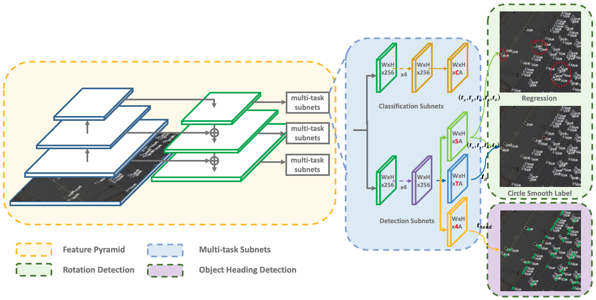
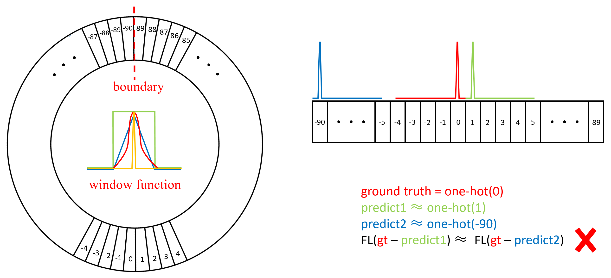
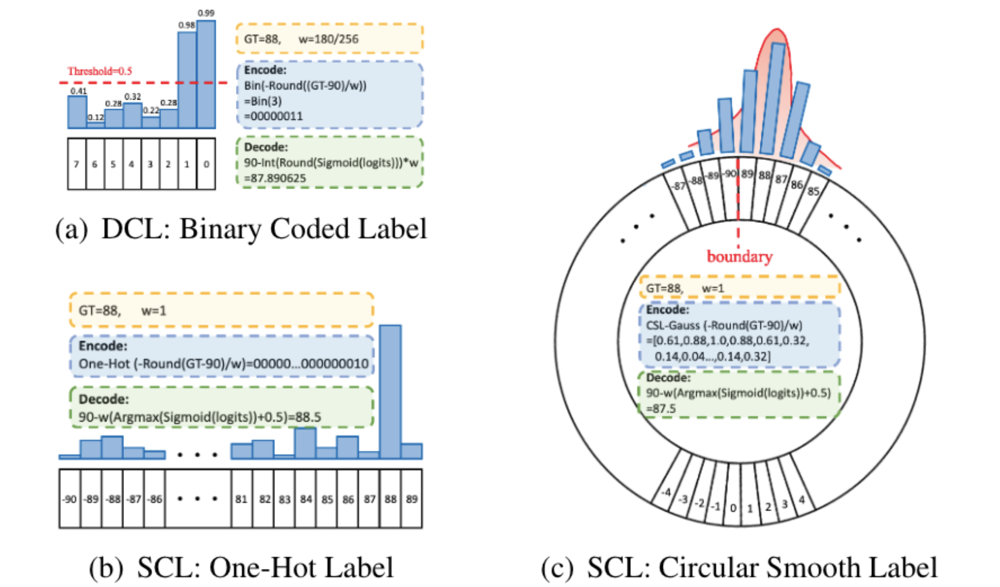
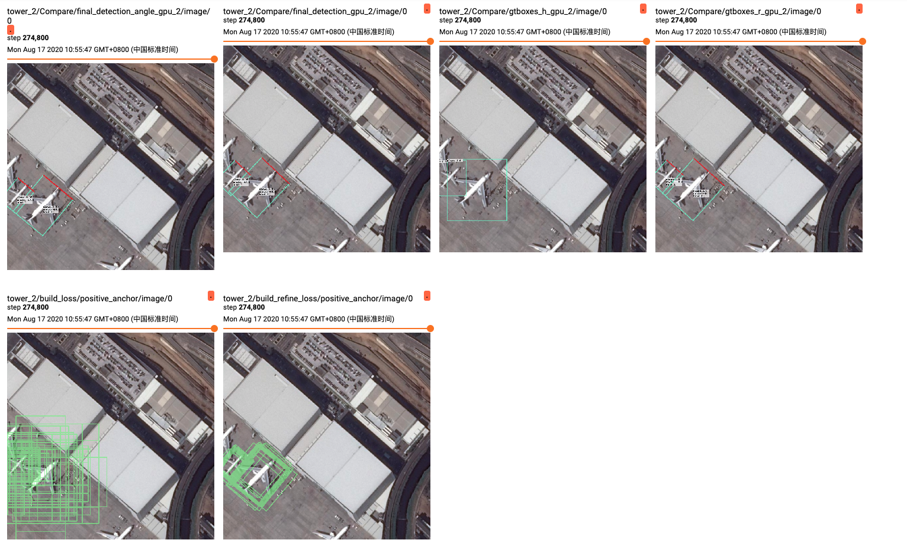

# BẢN DỊCH TIẾNG VIỆT — ON THE ARBITRARY-ORIENTED OBJECT DETECTION: CLASSIFICATION BASED APPROACHES REVISITED

> **Bài báo gốc:** Xue Yang, Junchi Yan, *On the Arbitrary-Oriented Object Detection: Classification Based Approaches Revisited*, **International Journal of Computer Vision (IJCV)**, 2022. DOI: [10.1007/s11263-022-01593-w](https://doi.org/10.1007/s11263-022-01593-w).  
> **Bản đối chiếu:** [2003.05597v4.pdf](./2003.05597v4.pdf), 19 trang, arXiv v4 ngày 23/03/2022.  
> **Quy ước bản dịch:** Giữ **thứ tự, cách đánh số đề mục, công thức trọng tâm và nhãn hình/bảng** theo bản PDF. Một số đoạn khảo cứu dài và các bảng đối chứng hàng chục phương pháp được diễn đạt cô đọng bằng tiếng Việt để dễ đọc trong Markdown; khi trích dẫn học thuật chính thức, cần kiểm tra lại bảng và thuật ngữ ở PDF gốc.  
> **Nguồn hình ảnh:** Các hình minh họa được đưa vào thư mục [hinh_bai_bao](./hinh_bai_bao/) từ **mã nguồn/hình do chính nhóm tác giả công bố**, không phải hình tự vẽ. Đây là hình nguồn tác giả tương ứng với nội dung bài báo; **chưa phải ảnh crop trực tiếp từ từng trang của PDF**. Để đối chiếu vị trí chính xác, đã có đường dẫn PDF kèm số trang tại từng hình.

---

# Tên bài báo

**Xem xét lại các phương pháp dựa trên phân loại cho bài toán phát hiện đối tượng có hướng quay tùy ý**  
(*On the Arbitrary-Oriented Object Detection: Classification Based Approaches Revisited*)

**Tác giả:** Xue Yang và Junchi Yan — Shanghai Jiao Tong University.

## Tóm tắt (Abstract)

Phát hiện đối tượng có hướng quay tùy ý là một thành phần cơ bản của các tác vụ thị giác nhạy cảm với góc quay. Trước hết, chúng tôi chỉ ra rằng vấn đề gián đoạn tại biên trong các bộ phát hiện xoay dựa trên hồi quy xuất phát từ tính tuần hoàn của góc hoặc thứ tự các đỉnh, tùy theo quy ước tham số hóa. Nguyên nhân sâu xa là giá trị dự đoán lý tưởng đôi khi nằm ngoài miền giá trị được quy định.

Từ nhận xét đó, chúng tôi chuyển bài toán dự đoán góc từ hồi quy sang phân loại. Đối với các nhãn góc phân bố trên một đường tròn, chúng tôi đề xuất kỹ thuật **Circular Smooth Label (CSL)** nhằm xử lý tính tuần hoàn và tăng khả năng chấp nhận sai số tại các góc kề nhau. Để hạn chế số tham số gia tăng do CSL, chúng tôi phát triển **Densely Coded Labels (DCL)**, giúp rút ngắn đáng kể chiều dài mã hóa. Cuối cùng, chúng tôi xây dựng mô-đun **Object Heading Detection**, hữu ích khi cần biết đối tượng đang hướng đầu về phía nào, chẳng hạn tàu và máy bay. Chúng tôi công bố tập dữ liệu **OHD-SJTU** cùng bộ phát hiện **OHDet**.

Các thí nghiệm trên DOTA, HRSC2016, OHD-SJTU, FDDB, ICDAR2015 và MLT cho thấy hiệu quả và khả năng áp dụng của những phương pháp đề xuất.

**Từ khóa:** Phát hiện vật thể xoay tùy ý; vấn đề biên; Circular Smooth Label; Densely Coded Labels; Object Heading Detection.

---

# 1. GIỚI THIỆU (INTRODUCTION)

Phát hiện đối tượng là một bài toán cơ bản trong thị giác máy tính. Gần đây, việc phát hiện đối tượng có hướng quay trở nên quan trọng đối với ảnh chụp từ trên cao, nhận diện văn bản trong ảnh và nhận diện khuôn mặt. Khác với hộp giới hạn nằm ngang (*horizontal bounding box*, HBB), hộp giới hạn xoay (*oriented bounding box*, OBB) cung cấp thông tin về vị trí, tỷ lệ kích thước và góc quay của đối tượng.

Phần lớn các bộ phát hiện xoay trước đây dự đoán OBB bằng cách **hồi quy** năm tham số hoặc hồi quy trực tiếp bốn đỉnh của tứ giác. Dù đã đạt hiệu quả tốt, các phương pháp này vẫn có những tình huống biên khiến hàm mất mát thay đổi đột ngột. Đối với cách biểu diễn năm tham số, hiện tượng thường gắn với chu kỳ góc; đối với cách biểu diễn tứ giác, hiện tượng liên quan đến việc sắp xếp các đỉnh.

Vấn đề không nằm ở riêng việc sử dụng năm hay tám tham số. Khi một hộp xoay thực tế nằm gần ranh giới của miền định nghĩa, lời giải hình học đúng nhất có thể yêu cầu một giá trị nằm ngoài miền cho phép. Mô hình hồi quy khi đó bị phạt quá lớn mặc dù hai hộp gần tương đương về hình học. Với các đối tượng thuôn dài, sai lệch góc nhỏ còn có thể làm giảm mạnh **Intersection over Union (IoU)**.

Chúng tôi cho rằng cách tiếp cận căn bản là biến bài toán dự đoán góc thành **phân loại góc**. Lúc này, mô hình lựa chọn một bin nằm trong miền góc hữu hạn thay vì hồi quy một giá trị có thể vượt biên. Để nhãn phân loại vẫn thể hiện tính gần nhau và tính tuần hoàn của các góc, chúng tôi thiết kế CSL; để giảm số chiều và chi phí của đầu ra phân loại, chúng tôi thiết kế DCL.

Khi góc được chia thành những khoảng đủ nhỏ, sai số lý thuyết do lượng tử hóa có thể rất thấp. Bài báo còn mở rộng phương pháp bằng **angle fine-tuning**, dự đoán phần dư trong bin, và **OHDet** để xác định đầu đối tượng. Nội dung sơ bộ của CSL và DCL đã được công bố lần lượt tại ECCV 2020 và CVPR 2021; bản tạp chí này cung cấp phân tích và thí nghiệm toàn diện hơn.

### Hình 1. Kiến trúc bộ phát hiện đề xuất

*Hình từ repository OHDet chính thức của tác giả, thể hiện backbone/FPN, các đầu ra phân loại, hồi quy box, CSL/DCL và dự đoán đầu đối tượng; xem [PDF gốc, trang 2, Hình 1](./2003.05597v4.pdf#page=2).*

**Diễn giải cấu trúc Hình 1:** Bài báo dùng **RetinaNet** làm ví dụ mô hình cụ thể, với CNN **ResNet + Feature Pyramid Network (FPN)**. Sau các bản đồ đặc trưng nhiều tỷ lệ, mô hình chia thành đầu ra phân loại loại đối tượng và đầu ra dự đoán vị trí/kích thước/góc; góc có thể dùng hồi quy, CSL hoặc DCL. Khi thực hiện OHDet, mạng dự đoán thêm **nhãn vị trí đầu đối tượng**. Đây **không phải một backbone CNN hoàn toàn mới** và cũng **không phải YOLO mặc định**.

Các đóng góp chính gồm: phân tích nguyên nhân vấn đề biên; xây dựng bài toán phân loại góc độ phân giải cao; thiết kế CSL, DCL và tinh chỉnh góc; phát triển OHDet cùng dataset OHD-SJTU; đánh giá trên nhiều kiến trúc và bộ dữ liệu khác nhau.

---

# 2. CÁC CÔNG TRÌNH LIÊN QUAN (RELATED WORK)

## 2.1. Phát hiện đối tượng bằng hộp giới hạn nằm ngang (Horizontal Region Object Detection)

Phát hiện đối tượng truyền thống thường sử dụng HBB. Các mô hình thuộc họ **R-CNN**, **Fast R-CNN**, **Faster R-CNN** và **R-FCN** từng bước nâng cao hiệu quả phát hiện và tốc độ. **FPN** xử lý sự thay đổi kích thước của vật thể bằng cách kết hợp các bản đồ đặc trưng ở nhiều cấp. Các bộ phát hiện một giai đoạn như **SSD, YOLO và RetinaNet** thường có ưu điểm về tốc độ.

Ngoài những phương pháp sử dụng anchor, các bộ phát hiện không sử dụng anchor cũng phát triển mạnh; ví dụ **CornerNet, CenterNet, ExtremeNet** sử dụng các điểm đặc trưng như đỉnh hoặc tâm để tái tạo bounding box.

Tuy nhiên, HBB tự nó không biểu diễn chính xác chiều quay hoặc tỷ lệ kích thước theo trục chính của một vật thể có hướng quay tùy ý.

## 2.2. Phát hiện đối tượng có hướng quay tùy ý (Arbitrary-Oriented Object Detection)

Phát hiện đối tượng xoay thường xuất hiện trong ảnh hàng không/viễn thám và phát hiện văn bản trong ảnh. Các phương pháp hiện có chủ yếu mở rộng detector truyền thống để hồi quy **OBB** hoặc **tứ giác bốn đỉnh**. Có thể phân chia thành hai nhóm: hồi quy năm tham số gồm vị trí, hai kích thước và góc; hoặc hồi quy tám tọa độ của bốn đỉnh.

Trong môi trường ảnh trên cao, nhiều đối tượng có kích thước rất nhỏ, bị xếp gần nhau và không có đặc trưng cục bộ rõ ràng để nhận diện từng đỉnh. Điều này khiến những phương pháp ước lượng góc dựa trên hình học vùng vật thể vẫn là lựa chọn quan trọng.

Những khó khăn về chu kỳ và thứ tự đỉnh là cơ sở để bài báo chuyển sang phân loại góc.

## 2.3. Phân loại để thu nhận thông tin hướng (Classification for Orientation Information)

Phân loại hướng đã từng được nghiên cứu cho khuôn mặt bị xoay trong mặt phẳng ảnh. Một số nghiên cứu chia miền hướng thành các khoảng thô rồi dùng nhiều mạng con hoặc mạng phân luồng để lựa chọn khoảng hướng; các nghiên cứu khác dần thu nhỏ miền góc rồi đưa ra dự đoán chính xác hơn.

Những phương pháp này thường cung cấp hướng gần đúng. Tuy nhiên, cách chia rất thô khó đáp ứng các bài toán phát hiện vật thể cần góc chính xác, đặc biệt với đối tượng thuôn dài trong ảnh hàng không hoặc chữ nghiêng. Phương pháp phân loại góc của bài báo vì thế được xây dựng với **độ phân giải bin mịn** hơn.

## 2.4. Phát hiện hướng đầu đối tượng (Object Heading Detection)

Các nghiên cứu trước về hướng đầu vật thể đã sử dụng nhận diện đầu xe trong ảnh trên cao, khai thác vị trí các bộ phận hoặc phân loại một vài hướng lớn. Một số tập dữ liệu nhỏ chỉ hỗ trợ một nhóm phương tiện và số lượng góc/hướng hạn chế.

Bài báo chỉ ra rằng **phát hiện OBB** và **phát hiện đầu đối tượng** không giống nhau: góc của hình chữ nhật vẫn có thể không phân biệt được hai hướng đối nhau. Vì vậy, cần thêm thông tin về phía đầu. Công trình này xây dựng OHDet và OHD-SJTU để cung cấp bài toán và benchmark về hướng đầu với nhiều loại vật thể hơn.

---

# 3. PHƯƠNG PHÁP (APPROACH)

## 3.1. Phương pháp phát hiện xoay dựa trên hồi quy (Regression-Based Rotation Detection Method)

Có hai quy ước OBB điển hình:

1. **Năm tham số:** \((x,y,w,h,\theta)\), trong đó góc có thể được định nghĩa theo miền 90° hoặc 180°.
2. **Tám tham số:** \((x_1,y_1,\ldots,x_4,y_4)\), mô tả trực tiếp tứ giác.

Với miền 90°, góc có thể được đo theo trục tương ứng một cạnh; tại một số cấu hình hình chữ nhật, cạnh được xem là chiều rộng/chiều cao có thể đổi vị trí khi đi qua biên. Với miền 180°, có thể cố định cạnh dài làm mốc đo góc.

Mô hình tứ giác có thêm yêu cầu sắp xếp các đỉnh đúng thứ tự. Nếu hai bộ đỉnh biểu diễn cùng một hình học nhưng khác thứ tự, loss hồi quy có thể tăng dù vùng hình học tương đương.

**Hình 2** của bài báo mô tả ba quy ước: OBB năm tham số với miền 90°; OBB năm tham số với miền 180°; và tứ giác có thứ tự các đỉnh. Xem [PDF, trang 4, Hình 2](./2003.05597v4.pdf#page=4).

## 3.2. Vấn đề biên của phương pháp hồi quy (Boundary Problem of Regression Method)

Bài báo định nghĩa hai loại vấn đề:

- **PoA — Periodicity of Angle:** Tính tuần hoàn của góc. Ví dụ hai góc ở hai đầu miền định nghĩa có thể gần nhau về hình học nhưng khác rất nhiều khi lấy hiệu số trực tiếp.
- **EoE — Exchangeability of Edges:** Khả năng hoán đổi các cạnh hay thứ tự đỉnh trong một biểu diễn OBB/tứ giác.

Nguyên nhân chung là dự đoán hình học lý tưởng có thể nằm ngoài miền số được cho phép. Mạng phải học một ánh xạ có bước nhảy tại biên, không phù hợp với hành vi liên tục của hình học.

**Hình 3–4** minh họa hiện tượng mất mát hồi quy tăng vọt tại biên và so sánh dự đoán thực tế khi sử dụng các mô hình hồi quy, phân loại góc và cửa sổ CSL. Xem [PDF, trang 4–6](./2003.05597v4.pdf#page=4).

## 3.3. Phân loại góc thông thường (Vanilla Angular Classification)

Thay vì dự đoán trực tiếp \(\theta\), tác giả chia miền góc \(\mathrm{AR}\) thành \(C_\theta\) lớp, với độ rộng mỗi lớp:

$$
\omega=\frac{\mathrm{AR}}{C_\theta}.
$$

Khi sử dụng argmax để chọn góc đại diện của bin, sai số lượng tử hóa lớn nhất về lý thuyết là:

$$
\boxed{\max(e)=\frac{\omega}{2}}
\tag{1a}
$$

Nếu giả định góc thực phân bố đều bên trong mỗi bin, sai số tuyệt đối trung bình do **chỉ riêng việc lượng tử hóa** là:

$$
\boxed{\mathbb{E}[|e|]=\frac{\omega}{4}.}
\tag{1b}
$$

Đây là Eq. (1) của bài báo. Sai số mô hình thực tế có thể lớn hơn rất nhiều vì còn nhầm bin, sai lệch phát hiện, che khuất và nhiễu ảnh.

Với quy ước góc OBB được tác giả sử dụng, quá trình mã hóa/giải mã có dạng:

$$
\begin{aligned}
\text{Encode: }&\operatorname{OneHot}\!\left(-\operatorname{Round}\left(\frac{\theta_{gt}-90}{\omega}\right)\right),\\
\text{Decode: }&90-\omega\left[0.5+\operatorname{Argmax}\big(\operatorname{Sigmoid}(\mathrm{logits})\big)\right].
\end{aligned}
\tag{2}
$$

Mã hóa one-hot cho phép loại bỏ bước nhảy hồi quy ra ngoài miền góc. Tuy nhiên, **one-hot không thể hiện tính gần nhau**: một dự đoán sai 1° và một dự đoán sai 90° có thể bị phạt theo cùng nguyên lý nếu cả hai đều không phải lớp đúng.

## 3.4. Circular Smooth Label cho phân loại góc (Circular Smooth Label for Angular Classification)

Đây là phần quan trọng nhất để đối chiếu với **Soft Angular BCE** của Leanbot.

Tác giả đưa ra hai nhận xét: thứ nhất, quy ước OBB miền 90° vẫn tồn tại khả năng hoán đổi cạnh; thứ hai, phân loại góc thông thường không coi trọng khoảng cách giữa góc thật và góc dự đoán. Khi \(\theta_{gt}=0^\circ\), việc dự đoán \(1^\circ\) về trực giác phải được chấp nhận nhiều hơn dự đoán một góc rất xa; nhưng nhãn one-hot không phản ánh sự khác biệt này.

**CSL** sử dụng một hàm cửa sổ \(g\) quanh góc đúng \(\theta\):

$$
\mathrm{CSL}(x)=
\begin{cases}
g(x),&\theta-r<x<\theta+r,\\
0,&\text{trường hợp khác}.
\end{cases}
\tag{3}
$$

Khi áp dụng trên đường tròn, hàm cửa sổ phải thỏa các tính chất:

- **Tuần hoàn:** \(g(x)=g(x+kT)\), trong đó \(T=180/\omega\) là số bin cho quy ước OBB chu kỳ 180°.
- **Đối xứng:** Giá trị nhãn hai phía cách đều tâm góc là như nhau.
- **Giá trị cực đại tại góc thật:** \(g(\theta)=1\).
- **Giảm dần theo khoảng cách:** Bin càng cách xa góc thật thì mục tiêu càng nhỏ trong cửa sổ.

Bài báo khảo sát **bốn cửa sổ**: *pulse*, *rectangular*, *triangular* và *Gaussian*. Khi dùng cửa sổ pulse hoặc bán kính rất nhỏ, CSL trở về gần nhãn one-hot. Khi dùng Gaussian phù hợp, các bin kề nhau nhận nhãn trung gian và biên chu kỳ được nối liên tục.

### Hình 5. So sánh nhãn One-hot và Circular Smooth Label

*Hình về Circular Smooth Label từ [repository CSL chính thức](https://github.com/Thinklab-SJTU/CSL_RetinaNet_Tensorflow). Đối chiếu sơ đồ trong [PDF, trang 6, Hình 5](./2003.05597v4.pdf#page=6).*

Quá trình mã hóa/giải mã CSL trong Eq. (4) của bài báo là:

$$
\begin{aligned}
\text{Encode: }&\operatorname{CSL}\left(-\operatorname{Round}\left(\frac{\theta_{gt}-90}{\omega}\right)\right),\\
\text{Decode: }&90-\omega\left[\operatorname{Argmax}\big(\operatorname{Sigmoid}(\mathrm{logits})\big)+0.5\right].
\end{aligned}
\tag{4}
$$

**Điểm rất quan trọng:** Bản CSL cơ sở **vẫn giải mã bằng argmax**, tức xuất góc đại diện bin. Nhãn Gaussian có vai trò **huấn luyện**, không phải mặc nhiên là bộ giải mã góc liên tục. Bản IJCV tiếp tục đưa ra **angle fine-tuning** ở Mục 3.6.

**Chú ý:** Tác giả nêu rõ CSL xử lý **PoA**, trong khi **EoE** còn cần được xử lý bằng lựa chọn quy ước hộp thích hợp, đặc biệt là quy ước góc 180°.

## 3.5. Nhãn mã hóa mật độ cao cho phân loại góc (Densely Coded Label for Angular Classification)

CSL sử dụng số lượng giá trị bằng số bin góc. Nếu miền góc có độ rộng \(\mathrm{AR}\) và bước góc \(\omega\):

$$
L_{\mathrm{onehot}}=L_{\mathrm{CSL}}=\frac{\mathrm{AR}}{\omega}.
\tag{5}
$$

Để giảm số chiều, tác giả sử dụng hai dạng **DCL**:

- **BCL — Binary Coded Label:** Biểu diễn chỉ số bin bằng chuỗi nhị phân.
- **GCL — Gray Coded Label:** Mã Gray, trong đó các mã liền kề khác nhau một bit; tính chất này có lợi cho các bin lân cận.

**Bảng 1 — Ví dụ mã nhị phân và mã Gray ba bit:**

| Giá trị thập phân | 0 | 1 | 2 | 3 | 4 | 5 | 6 | 7 |
|---|---|---|---|---|---|---|---|---|
| BCL | 000 | 001 | 010 | 011 | 100 | 101 | 110 | 111 |
| GCL | 000 | 001 | 011 | 010 | 110 | 111 | 101 | 100 |

Độ dài mã DCL là:

$$
L_{\mathrm{DCL}}=
\left\lceil\log_2\frac{\mathrm{AR}}{\omega}\right\rceil.
\tag{6}
$$

Với ví dụ \(\mathrm{AR}=180^\circ\), \(\omega=1^\circ\), CSL cần **180 chiều** nhưng DCL chỉ cần **8 bit**.

Số kênh dự đoán của một lớp convolution được viết:

$$
C_o=A\,L,
\tag{7}
$$

trong đó \(A\) là số anchor và \(L\) là chiều dài mã. Tổng chi phí tính toán/khối lượng tham số của lớp dự đoán tỷ lệ với kích thước feature map, kích thước kernel, số kênh vào/ra; vì vậy rút ngắn \(L\) giảm đáng kể chi phí đầu ra.

**Bảng 2 — So sánh chi phí mô hình (RetinaNet, theo bài báo):**

| Phương pháp | GFLOPs | Tham số | Chênh GFLOPs so với hồi quy | Chênh tham số |
|---|---:|---:|---:|---:|
| Hồi quy góc | 139,35 | 36,97 M | — | — |
| CSL, bước 1° | 254,96 | 45,63 M | +82,96% | +23,42% |
| GCL, bước 1° | 143,87 | 37,31 M | +3,24% | +0,92% |

Như vậy, DCL giảm đáng kể chi phí so với CSL khi số bin lớn. **Con số phần trăm tham số đúng theo Bảng 2 là +23,42%**, không phải +45,63%.

**Hình 6 — Quan hệ giữa các cách mã hóa góc**

*Minh họa lấy từ [repository DCL chính thức](https://github.com/Thinklab-SJTU/DCL_RetinaNet_Tensorflow); đối chiếu [PDF, trang 7–8, Hình 6–7](./2003.05597v4.pdf#page=7).*

DCL giải mã chuỗi nhị phân sau khi sigmoid/đưa về bit. Với BCL, tác giả biểu diễn tương ứng:

$$
\begin{aligned}
\text{Encode: }&\operatorname{Bin}\left(-\operatorname{Round}\left(\frac{\theta_{gt}-90}{\omega}\right)\right),\\
\text{Decode: }&90-\omega\,\operatorname{Int}\big(\operatorname{Round}(\operatorname{Sigmoid}(\mathrm{logits}))\big).
\end{aligned}
\tag{9}
$$

Mã Gray có bước giải mã tương ứng trước khi chuyển về chỉ số bin. Một số chuỗi bit có thể biểu diễn mã không hợp lệ nếu số mã có thể biểu diễn vượt số bin thực, nhưng tác giả quan sát thấy điều này không gây giảm hiệu năng lớn trong thiết lập của họ.

## 3.6. Tinh chỉnh góc (Angle Fine-Tuning)

Tăng \(\omega\) giúp giảm số bin và chi phí của nhánh phân loại; ngược lại, độ rộng mỗi bin lớn hơn khiến sai số lượng tử hóa đáng chú ý. Để khắc phục, bài báo bổ sung **một giá trị hồi quy phần dư** trong mỗi bin.

Đặt:

$$
\theta_{\mathrm{disc}}=\operatorname{Decode}(\operatorname{Encode}(\theta_{gt})),
$$

$$
\varepsilon_{gt}=\theta_{gt}-\theta_{\mathrm{disc}},
\qquad
\varepsilon_{gt}\in\left[-\frac{\omega}{2},\frac{\omega}{2}\right].
\tag{10}
$$

Mô hình dự đoán một logit \(\varepsilon_{\mathrm{logits}}\) độc lập. Phần dư suy ra là:

$$
\varepsilon_{\mathrm{pred}}=
\left[\operatorname{Sigmoid}(\varepsilon_{\mathrm{logits}})-0.5\right]\omega,
$$

và góc được tinh chỉnh:

$$
\theta'_{\mathrm{pred}}=
\min\!\left(\max(\theta_{\mathrm{pred}}+\varepsilon_{\mathrm{pred}},-90^\circ),90^\circ\right).
\tag{11}
$$

Phép chặn cuối thuộc **quy ước góc OBB** trong bài báo; khi chuyển sang heading 360°, cần dùng phép chuẩn hóa tuần hoàn thích hợp, không sao chép nguyên khoảng \([-90^\circ,90^\circ]\).

**Ý nghĩa:** Tác giả không chỉ đề xuất phân loại góc rời rạc; họ đã có **một cơ chế dự đoán góc liên tục dưới độ rộng của bin**. Đây là baseline mà một nghiên cứu Leanbot dùng circular mean cần đối chiếu.

## 3.7. Bộ phát hiện hướng đầu đối tượng (Object Heading Detector)

Phát hiện OBB chỉ cho biết trục xoay/hình dạng hình chữ nhật, chưa quyết định phía nào là **đầu**. Tác giả quan sát thấy khi đã có OBB, vị trí đầu đối tượng có thể quy về **bốn khả năng định hướng tương đối** trên hộp, vì thế chỉ cần dự đoán thêm một nhãn **bốn lớp**.

**Hình 8 — Quy định nhãn hướng đầu:** Dấu màu đỏ đánh dấu đầu đối tượng; chấm xanh biểu thị tâm OBB; đường đứt nét vàng nối tâm với đầu và **vùng góc phần tư** chứa hướng này xác định nhãn. Xem [PDF, trang 8, Hình 8](./2003.05597v4.pdf#page=8).

Một bộ phát hiện heading hiệu quả phải: dự đoán OBB chính xác ở tình huống thông thường và không quá nhạy với lỗi biên. Vì vậy, tác giả sử dụng cấu trúc tinh chỉnh nhiều giai đoạn kết hợp CSL/DCL:

1. Giai đoạn đầu vẫn ưu tiên **hồi quy hộp** để có tập anchor ứng viên chất lượng, tránh làm chi phí đầu ra phân loại góc quá lớn khi số anchor nhiều.
2. Sau khi tinh chỉnh anchor, chỉ giữ ứng viên mạnh nhất tại vị trí đặc trưng ở các tầng kế tiếp; số anchor hiệu dụng giảm, tạo điều kiện sử dụng nhánh angle classification.
3. Sử dụng quy ước góc 90° để giảm chiều dài miền góc ở các tầng phù hợp; kết hợp **IoU-Smooth L1** để xử lý các vấn đề liên quan biên và hoán đổi cạnh.
4. Bổ sung nhánh **bốn lớp hướng đầu** trên nền rotated detection.

**Đây là điểm trực tiếp liên quan Leanbot:** OHDet *không* gán 24 nhãn hướng vào object-class head như Leanbot. Nó biểu diễn thông tin hướng thành **góc OBB + nhãn đầu bốn lớp**, rồi kết hợp để suy ra phía đầu của đối tượng.

Phương pháp đầy đủ gọi là **OHDet**. Mã nguồn được nhóm tác giả công bố tại [OHDet_Tensorflow](https://github.com/SJTU-Thinklab-Det/OHDet_Tensorflow).

## 3.8. Thiết kế hàm mất mát (Loss Function Design)

Để so sánh công bằng, tác giả giữ đồng thời khả năng dùng **hồi quy góc** và **phân loại góc** trong một hệ đa nhiệm. Với tọa độ tâm/hình dạng box được chuẩn hóa theo anchor:

$$
t_x=\frac{x-x_a}{w_a},\quad
t_y=\frac{y-y_a}{h_a},\quad
t_w=\log\frac{w}{w_a},\quad
t_h=\log\frac{h}{h_a}.
\tag{12–13}
$$

Đối với hồi quy góc trực tiếp:

$$
t_\theta=(\theta-\theta_a)\frac{\pi}{180}.
\tag{14}
$$

Một baseline hồi quy gián tiếp là dự đoán hai thành phần:

$$
t_{\sin\theta}=\sin\left(\theta\frac{\pi}{180}\right),\qquad
t_{\cos\theta}=\cos\left(\theta\frac{\pi}{180}\right),
\tag{15}
$$

rồi chuẩn hóa vector để tổng bình phương hai thành phần bằng một (Eq. 16). Điều này cho thấy bài báo **đã so sánh trực tiếp với hướng hồi quy sin/cos**.

Hàm mất mát tổng gồm năm nhóm:

$$
\mathcal L=
\lambda_1\mathcal L_{\mathrm{box}}+
\lambda_2\mathcal L_{\mathrm{angle}}+
\lambda_3\mathcal L_{\mathrm{residual}}+
\lambda_4\mathcal L_{\mathrm{head}}+
\lambda_5\mathcal L_{\mathrm{class}}.
\tag{17}
$$

Trong bài báo, các giá trị mặc định là:

$$
(\lambda_1,\lambda_2,\lambda_3,\lambda_4,\lambda_5)
=(1,\ 0.5,\ 20,\ 0.1,\ 1).
$$

Hàm \(\mathcal L_{\mathrm{class}}\), \(\mathcal L_{\mathrm{head}}\) và \(\mathcal L_{\mathrm{angle}}\) có thể dùng **focal loss** hoặc **sigmoid cross-entropy** tùy detector; các hạng hồi quy thường dùng **Smooth L1**.

**Lưu ý quan trọng:** CSL là cách **mã hóa nhãn cho hạng phân loại góc**; nó không có nghĩa toàn bộ hàm loss của hệ thống chỉ còn mỗi Gaussian BCE.

---

# 4. THỰC NGHIỆM (EXPERIMENTS)

Các tác giả triển khai phương pháp bằng **TensorFlow**, dùng GPU **GeForce RTX 2080 Ti 11 GB**. Backbone mặc định là **ResNet-50** nếu không ghi khác. Thí nghiệm sử dụng cả detector một giai đoạn và hai giai đoạn nhằm chứng minh khả năng chuyển giao kỹ thuật CSL/DCL.

Cấu hình tham khảo gồm weight decay \(10^{-4}\), momentum \(0.9\), huấn luyện trên 4 GPU với tổng batch size 4 (một ảnh/GPU), các tỷ lệ anchor \(\{1,1/2,2,1/4,4,1/6,6\}\) và thiết lập FPN/RetinaNet cơ sở.

## 4.1. Bộ dữ liệu và giao thức đánh giá (Benchmarks and Protocols)

**DOTA:** Ảnh chụp từ trên cao, vật thể thuộc nhiều loại kích thước/hình dạng/góc. DOTA-v1.0 có **2.806 ảnh**, 15 nhóm vật thể và **188.282 instances**, đánh nhãn bằng tứ giác. DOTA-v1.5 có thêm vật thể rất nhỏ; DOTA-v2.0 có **11.268 ảnh** và **1.793.658 instances**, 18 nhóm. Ảnh lớn được cắt thành các mảnh 600×600 pixel có vùng chồng 150 pixel rồi scale lên 800×800 để huấn luyện.

**ICDAR2015:** Tập phát hiện văn bản đa hướng trong ảnh thực tế; có **1.000 ảnh train** và **500 ảnh test**. Tác giả dùng dữ liệu ICDAR2017 MLT để huấn luyện sơ bộ rồi fine-tune bằng ICDAR2015.

**ICDAR2017 MLT:** Tập văn bản đa ngôn ngữ, gồm **7.200 train**, **1.800 validation** và **9.000 test**, với văn bản có thể xuất hiện ở các góc khác nhau.

**HRSC2016:** Ảnh tàu trên biển và gần bờ ở nhiều cảng, gồm **436 train**, **181 validation** và **444 test**.

**FDDB:** Tập phát hiện khuôn mặt trong điều kiện không kiểm soát, gồm **2.845 ảnh**, **5.171 khuôn mặt**. Bài báo dùng khoảng 70% để huấn luyện và phần còn lại để validation.

**OHD-SJTU:** Tập dữ liệu do tác giả xây dựng để đánh giá *cả phát hiện OBB lẫn hướng đầu đối tượng*:

- **OHD-SJTU-S:** 43 ảnh Google Earth kích thước lớn, 4.125 đối tượng (**3.343 tàu và 782 máy bay**); 30 ảnh nguồn cho train/validation, 13 ảnh nguồn cho test. Đối tượng được gán nhãn tứ giác; **đỉnh đánh dấu đầu tiên xác định vị trí đầu**.
- **OHD-SJTU-L:** Mở rộng từ dữ liệu có thêm các loại xe nhỏ, xe lớn, cảng, trực thăng, tổng cộng **113.435 instances** thuộc **6 nhóm**; một phần lấy từ DOTA-v1.0 nhưng nhãn được sửa và bổ sung thông tin vị trí đầu.

### Bảng 3. Phân bố nhãn OHD-SJTU (theo PDF)

| Tập | Máy bay | Tàu | Xe nhỏ | Xe lớn | Cảng | Trực thăng |
|---|---:|---:|---:|---:|---:|---:|
| L train | 8.614 | 30.386 | 26.126 | 16.969 | 5.983 | 630 |
| L val | 2.754 | 9.985 | 5.438 | 4.387 | 2.090 | 73 |
| S train | 559 | 2.318 | — | — | — | — |
| S val | 223 | 1.025 | — | — | — | — |

*Hai hàng S train/val trong Bảng 3 là cách chia theo bài báo, không thay thế thống kê tổng số và phân chia ảnh nguồn train/test.*

**Hình 9 — Mẫu dữ liệu có nhãn OHD-SJTU:** Ảnh vệ tinh được gán nhãn tứ giác và đánh dấu đầu đối tượng. Đối chiếu [PDF, trang 11](./2003.05597v4.pdf#page=11).

## 4.2. Nghiên cứu loại bỏ thành phần (Ablation Study)

### So sánh hồi quy và phân loại

Các tác giả sử dụng cùng thiết lập RetinaNet và DOTA-v1.0 validation để so sánh **hồi quy góc trực tiếp**, **hồi quy sin/cos**, **CSL**, **BCL**, **GCL**.

**Bảng 4 — So sánh phương pháp dự đoán góc trên DOTA-v1.0 validation**

| Phương pháp | Bước góc | AP50 | AP75 | AP50:95 |
|---|---|---:|---:|---:|
| Hồi quy trực tiếp \(\Delta\theta\) | — | 62,21 | 26,06 | 31,49 |
| Hồi quy gián tiếp \((\sin\theta,\cos\theta)\) | — | 63,23 | 30,63 | 33,19 |
| CSL | 1° | 64,40 | 32,58 | 35,04 |
| BCL | 180°/256 | 65,93 | 35,66 | 36,71 |
| GCL | 180°/256 | 66,13 | 33,65 | 36,34 |

Kết quả cho thấy trong thiết lập này các cách **phân loại góc** đạt hiệu quả OBB tốt hơn hồi quy. Tuy nhiên đây là **AP của phát hiện OBB**, không phải MAE của heading 360°.

### So sánh bốn dạng cửa sổ CSL

Các cửa sổ được đánh giá dưới cùng điều kiện để kiểm tra khả năng học thông tin góc. Kết quả cho thấy cửa sổ **Gaussian** hoạt động tốt nhất trong các dạng được thử, còn cửa sổ pulse thường kém hơn. Tác giả nhấn mạnh việc đổi sang miền 180° làm giảm vấn đề hoán đổi cạnh còn tồn tại ở một số cấu hình miền 90°.

**Bảng 5 — mAP trên DOTA-v1.0 test (miền góc 180°, radius = 6):**

| Cửa sổ | mAP |
|---|---:|
| Pulse | 42,06 |
| Rectangular | 61,98 |
| Triangular | 57,94 |
| Gaussian | **65,69** |

### Ảnh hưởng bán kính cửa sổ

Bán kính quá nhỏ biến nhãn gần thành one-hot; bán kính quá lớn khiến các bin khó phân biệt. Trong cấu hình thử nghiệm, cả RetinaNet-CSL và FPN-CSL đạt mAP cao nhất ở **radius = 6**, nhưng không có nghĩa mọi dataset và mọi bước góc đều nên dùng cùng một radius.

**Bảng 6 — So sánh bán kính Gaussian:**

| Detector | r=0 | r=2 | r=4 | r=6 | r=8 |
|---|---:|---:|---:|---:|---:|
| RetinaNet-CSL | 40,78 | 59,23 | 62,12 | **65,69** | 63,99 |
| FPN-CSL | 48,08 | 70,18 | 70,09 | **70,92** | 69,75 |

### Ảnh hưởng độ phân giải rời rạc \(\omega\)

Góc chia nhỏ thường giúp tăng độ chính xác biểu diễn, nhưng quá nhiều bin làm tăng độ khó phân loại và số chiều đầu ra. Bài báo đánh giá nhiều mức \(\omega\) và thấy cấu hình tối ưu phụ thuộc giao thức đánh giá IoU, detector và dữ liệu. Do đó **bước góc nhỏ hơn không bảo đảm mAP cao hơn trong mọi trường hợp**. Xem Bảng 7–8 trong [PDF, trang 10–12](./2003.05597v4.pdf#page=10).

### Tác động của miền góc và loại anchor

Tác giả khảo sát H-anchor/R-anchor, miền 90° và 180°, các detector như RetinaNet, FPN, R³Det. Kết quả chỉ ra việc dùng phương pháp phân loại góc cần phối hợp với **quy ước góc đúng**, nếu không vấn đề EoE vẫn còn. Các kết quả chi tiết nằm ở Bảng 9.

### Kiểm chứng khả năng tổng quát sang nhiều dữ liệu

CSL/GCL/BCL được thử trên DOTA-v1.0/v1.5/v2.0, ICDAR2015, MLT, HRSC2016 và FDDB. Kết quả có cải thiện ở nhiều chỉ số, đặc biệt khi đối tượng dài, góc nằm sát biên hoặc yêu cầu IoU cao; mức cải thiện không đồng nhất giữa dataset và chỉ số.

### Tác động của angle fine-tuning

Bài báo dùng HRSC2016 để chứng minh rằng hồi quy phần dư giúp giảm sai số khi \(\omega\) lớn. Đặc biệt, các chỉ số chính xác cao như **AP75** thể hiện lợi ích rõ hơn AP50, bởi ngưỡng IoU=0,5 cho phép nhiều sai lệch góc hơn.

**Bảng 12 — Ví dụ trên HRSC2016 với CSL:**

| Bước \(\omega_{\mathrm{CSL}}\) | Fine-tuning | AP50 | AP75 |
|---|---|---:|---:|
| 18° | Không | 46,72 | 3,68 |
| 18° | Có | **76,17** | **20,47** |
| 10° | Không | 74,07 | 16,89 |
| 10° | Có | **81,41** | **32,57** |
| 1° | Không | 81,17 | 44,75 |
| 1° | Có | **81,37** | **46,51** |

Đây là minh chứng trực tiếp rằng bài báo **đã nghiên cứu cơ chế vượt độ rộng bin**, thay vì chỉ giải mã argmax rời rạc.

### Phân tích trực quan đặc trưng góc

Thông qua phân tích PCA các đặc trưng RoI, tác giả nhận thấy nhãn pulse làm các góc khó hình thành quan hệ hình học rõ ràng; ngược lại, Gaussian CSL khiến các vector đặc trưng của góc lân cận có xu hướng nằm gần nhau và phân bố theo cấu trúc vòng. Điều này phù hợp với mục tiêu đưa chu kỳ và lân cận góc vào quá trình huấn luyện.

**Hình 10–14** thể hiện ảnh hưởng radius, độ mịn góc và phân bố đặc trưng; đối chiếu [PDF, trang 11–15](./2003.05597v4.pdf#page=11).

## 4.3. So sánh với các phương pháp tiên tiến (Comparison with the State-of-the-Art Methods)

### HRSC2016

Dataset này chủ yếu gồm tàu có tỷ lệ cạnh dài, nên sai lệch hướng làm suy giảm chất lượng hộp phát hiện rõ rệt. Khi áp dụng các nhãn CSL/GCL/BCL và backbone phù hợp, tác giả báo cáo kết quả cạnh tranh với những phương pháp phát hiện tàu xoay trước đó.

**Ví dụ từ Bảng 13 (HRSC2016, ResNet-101):**

| Phương pháp | mAP (VOC07) | mAP (VOC12) |
|---|---:|---:|
| CSL | 89,62 | 96,10 |
| GCL | 89,56 | 96,02 |
| BCL | 89,46 | 96,41 |

### ICDAR2015 và ICDAR2017 MLT

Bài báo so sánh với các bộ phát hiện văn bản nhiều góc chuyên biệt, gồm các mô hình sử dụng dữ liệu huấn luyện bổ sung hoặc tiền huấn luyện mạnh. Nhóm tác giả xem CSL/DCL là công cụ tổng quát cho phát hiện vật thể xoay, không phải kiến trúc riêng thiết kế cho văn bản; các giá trị precision, recall và F-measure cụ thể được trình bày trong Bảng 14 và các kết quả MLT.

### DOTA

Trong DOTA, hiệu quả thay đổi theo backbone và độ phức tạp của cảnh. Tác giả kiểm tra trên nhiều loại vật thể như máy bay, cầu, tàu, xe, bến cảng, sân thể thao và các công trình. Kết quả so sánh theo từng lớp và mAP tổng hợp nằm ở Bảng 15. Ý nghĩa chính của thí nghiệm là tính **khả chuyển** của CSL/DCL sang nhiều detector và nhiều loại đối tượng.

### OHD-SJTU

Khi đánh giá OBB trên OHD-SJTU, tác giả so sánh OHDet với R²CNN, RRPN, RetinaNet-H, RetinaNet-R và R³Det. Việc kết hợp phát hiện xoay và dự đoán hướng đầu được phân tích chi tiết trong mục tiếp theo.

## 4.4. Thí nghiệm phát hiện hướng đầu đối tượng (Object Heading Detection Experiment)

Ở **OBB detection**, một dự đoán được đánh giá theo lớp đối tượng và mức độ trùng hộp với ground truth, chẳng hạn IoU vượt 0,5. Với **object heading detection**, còn phải dự đoán đúng **phía đầu của đối tượng**.

Bài báo sử dụng ba nhóm thước đo:

- **OBB mAP:** Đo chất lượng phát hiện hộp xoay, chưa kiểm tra đầu–đuôi.
- **OHD mAP:** Đo phát hiện có xét thêm tính đúng của nhãn đầu đối tượng.
- **Head Accuracy:** Độ chính xác của nhãn đầu trong các detection box đã được đánh giá là true positive.

Nếu cùng một mô hình, OHD mAP bị giới hạn trên bởi OBB mAP, bởi để được tính đúng theo OHD cần đồng thời phát hiện đúng hộp và đúng đầu.

### Bảng 18 — Kết quả OHD-SJTU (các cột tổng hợp)

| Dataset | Tác vụ | IoU50 | IoU75 | IoU50:95 |
|---|---|---:|---:|---:|
| OHD-SJTU-S | OBB | 89,66 | 75,62 | 61,49 |
| OHD-SJTU-S | OHD | 81,65 | 65,51 | 55,09 |
| OHD-SJTU-S | Head Accuracy | 92,89 | 93,81 | **94,25** |
| OHD-SJTU-L | OBB | 65,92 | 38,80 | 37,66 |
| OHD-SJTU-L | OHD | 38,04 | 24,86 | 22,97 |
| OHD-SJTU-L | Head Accuracy | 64,41 | 65,17 | **64,12** |

Các cột IoU50, IoU75, IoU50:95 phản ánh giao thức lọc detection và thống kê theo ngưỡng IoU; **Head Accuracy không phải lỗi góc tính bằng độ**.

### Hình 15. Một số kết quả dự đoán OBB và hướng đầu

*Hình minh họa từ repository OHDet chính thức; xem đồng thời [PDF gốc, trang 16–17, Hình 15–16](./2003.05597v4.pdf#page=16).*

Tác giả nhận thấy OHD-SJTU-S có ảnh rõ, đối tượng tương đối lớn nên Head Accuracy đạt khoảng 94,25%. Trên OHD-SJTU-L, cảnh phức tạp làm giảm đáng kể Head Accuracy còn khoảng 64,12%; mAP cũng giảm rõ khi điều kiện “dự đoán đúng đầu” được bổ sung.

Những trường hợp khó điển hình gồm: hình dạng đầu và đuôi gần giống nhau; vật thể rất nhỏ hoặc mờ; đối tượng tập trung dày đặc; và lớp có ít mẫu, chẳng hạn trực thăng.

**Liên hệ với robot:** Các số liệu này cho thấy **tách đầu–đuôi là nhiệm vụ khó hơn chỉ phát hiện góc OBB**, nhưng chưa thể so trực tiếp với dự đoán heading Leanbot vì định nghĩa nhãn và metric khác nhau.

---

# 5. KẾT LUẬN (CONCLUSION)

Bài báo phân tích vấn đề gián đoạn tại biên của những bộ phát hiện đối tượng xoay dựa trên hồi quy và chỉ ra nguyên nhân liên quan đến miền giá trị hợp lệ, chu kỳ góc và thứ tự hình học của OBB/tứ giác. Bằng cách chuyển góc thành bài toán phân loại, tác giả thiết kế **CSL** nhằm phản ánh tính tuần hoàn và chấp nhận hợp lý các lớp góc lân cận.

Để tránh làm số chiều đầu ra tăng quá cao ở góc phân giải mịn, bài báo thiết kế **DCL** dùng mã nhị phân hoặc mã Gray. **Angle fine-tuning** bổ sung phần dư liên tục để khắc phục sai số lượng tử hóa khi chia góc thành bin. Ngoài ra, tác giả phát triển **OHDet** để xác định đầu vật thể dựa trên kết quả phát hiện OBB, cùng tập dữ liệu OHD-SJTU có nhãn đầu.

Các kết quả thực nghiệm trên nhiều detector và dataset cho thấy CSL/DCL là các lựa chọn hiệu quả cho dự đoán góc của hộp xoay; đồng thời phát hiện hướng đầu là bài toán bổ sung khó hơn và chịu ảnh hưởng của độ mơ hồ hình dạng.

---

# TÀI LIỆU THAM KHẢO (REFERENCES)

**Các mục [1]–[86] và thông tin thư mục đầy đủ giữ nguyên theo bài báo gốc:** [2003.05597v4.pdf, trang 17–19](./2003.05597v4.pdf#page=17). Phần tài liệu tham khảo được giữ dưới dạng dẫn chiếu đến bản gốc để tránh dịch sai tên công trình, tên tác giả, tên hội nghị và DOI.

Các tài liệu nên mở song song khi đối chiếu kỹ thuật:

- **Bài đang dịch:** [On the Arbitrary-Oriented Object Detection: Classification Based Approaches Revisited, IJCV 2022](https://doi.org/10.1007/s11263-022-01593-w).
- **CSL gốc:** [Arbitrary-Oriented Object Detection with Circular Smooth Label, ECCV 2020](https://www.ecva.net/papers/eccv_2020/papers_ECCV/papers/123530664.pdf).
- **Mã nguồn CSL:** [Thinklab-SJTU/CSL_RetinaNet_Tensorflow](https://github.com/Thinklab-SJTU/CSL_RetinaNet_Tensorflow).
- **Mã nguồn DCL:** [Thinklab-SJTU/DCL_RetinaNet_Tensorflow](https://github.com/Thinklab-SJTU/DCL_RetinaNet_Tensorflow).
- **Mã nguồn OHDet:** [SJTU-Thinklab-Det/OHDet_Tensorflow](https://github.com/SJTU-Thinklab-Det/OHDet_Tensorflow).

---

# PHỤ LỤC RIÊNG: ĐỐI CHIẾU NHANH VỚI LEANBOT

> **Phần này do người biên soạn bổ sung, không thuộc nội dung nguyên bản của bài báo.** Đặt ngoài cấu trúc Mục 1–5 để tránh lẫn ý kiến phân tích với lời tác giả.

| Thành phần | IJCV 2022 | Leanbot đang triển khai |
|---|---|---|
| Mô hình nền | RetinaNet/FPN và các detector xoay khác | YOLO11n |
| Backbone điển hình | ResNet-50; một số thí nghiệm ResNet-101 | YOLO11n backbone |
| Nhãn phát hiện | Loại đối tượng + OBB + nhãn đầu nếu dùng OHDet | BBox ngang + 24 lớp heading của robot |
| Giám sát góc | CSL/DCL là các nhánh mã hóa góc; thêm residual | Gaussian circular targets trong BCE của detection-class head |
| Giải mã góc dưới-bin | Angle fine-tuning với residual head | Weighted Circular Mean từ các class scores |
| Hướng đầu | Góc OBB + phân loại bốn phía đầu | Học trực tiếp 24 heading bins |
| Đầu vào kiểm thử | Nhiều dataset ảnh vệ tinh, tàu, văn bản, khuôn mặt | Camera cố định nhìn chéo mặt phẳng robot |
| Metric | mAP, OHD mAP, Head Accuracy | Cần circular MAE/P90, latency và tỷ lệ heading đúng |

**Công thức Leanbot cần đối chiếu:**

$$
d(\theta_i,\theta_j)=\min\big(|\theta_i-\theta_j|,\ 360^\circ-|\theta_i-\theta_j|\big),
$$

$$
y_{ij}=a_i\exp\left(-\frac{d(\theta_i,\theta_j)^2}{2(15^\circ)^2}\right),
$$

$$
\hat{\theta}=\operatorname{atan2}
\left(\sum_{j=0}^{23}s_j\sin\theta_j,\
\sum_{j=0}^{23}s_j\cos\theta_j\right).
$$

**Kết luận phục vụ publication:** CSL Gaussian đã có từ trước; IJCV đã có angle fine-tuning và OHDet. Điểm Leanbot cần chứng minh bằng thí nghiệm là việc mã hóa heading thành 24 detection classes và tổng hợp các score/candidate mang lại lợi ích gì so với các cách đã công bố trong cùng điều kiện dữ liệu. Không nên gọi “CNN nhận dạng góc 360°”, “nhãn Gaussian tuần hoàn” hoặc “góc liên tục” là đóng góp mới nếu chưa có đối chứng.
